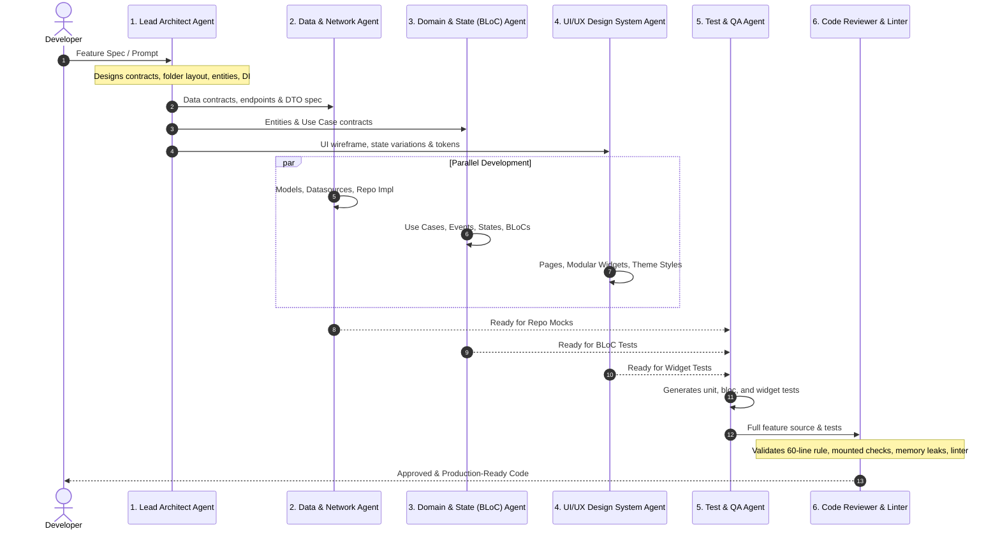

# Multi-Agent Orchestration System for Flutter Development

When vibe coding complex Flutter applications, using a single undifferentiated AI prompt produces disorganized, tightly-coupled code. 

This repository defines a **6-Agent System** where each agent possesses a specialized mandate, distinct system prompt, explicit input/output contracts, and rigid boundaries.

---

## 1. Agent Architecture & Hand-off Pipeline

---

## 2. Specialized Agent Profiles & Mandates

### 1. Lead Architect Agent (`@flutter-architect`)
- **Role**: Technical director and system planner.
- **Responsibilities**:
  - Break down user requests into Clean Architecture feature packages.
  - Define Domain Entities (`domain/entities/`).
  - Define abstract Repository interfaces (`domain/repositories/`).
  - Define Use Case signatures (`domain/usecases/`).
  - Plan Service Locator registrations (`core/di/injection.dart`).
- **Input**: User stories, Figma designs, API documentation.
- **Output**: File tree blueprint, interface definitions, entity models, and DI registration templates.
- **Strict Boundary**: **NEVER** write presentation widgets or raw HTTP networking calls.

---

### 2. Data & Network Agent (`@flutter-data`)
- **Role**: External data integration and persistence engineer.
- **Responsibilities**:
  - Implement remote data sources using `Dio` with retry policies and headers.
  - Implement local caching (Hive, Drift, or FlutterSecureStorage).
  - Create DTO Models with serialization (`fromJson`/`toJson`) and domain entity mapping (`toEntity()`).
  - Implement Repository interfaces from the Domain layer.
  - Translate low-level `Exception`s into domain `Failure`s using functional error handling (`Either<Failure, T>`).
- **Input**: Swagger/OpenAPI specs, endpoints, and domain repository interfaces.
- **Output**: Datasource classes, DTOs with serialization, and repository implementations.
- **Strict Boundary**: **NEVER** import `flutter/material.dart` or write widget/presentation code.

---

### 3. Domain & State (BLoC) Agent (`@flutter-bloc`)
- **Role**: Business logic and reactive state machine specialist.
- **Responsibilities**:
  - Implement UseCases that orchestrate repositories.
  - Define immutable BLoC States and Events using `Equatable` or `@freezed`.
  - Implement BLoC event handlers with proper concurrency control (`bloc_concurrency`: `restartable()`, `droppable()`).
  - Handle state lifecycle: `Initial`, `Loading`, `Success`, `Failure`.
- **Input**: UseCase specifications and UI state requirements.
- **Output**: UseCases, BLoCs/Cubits, States, and Events.
- **Strict Boundary**: **NEVER** write UI layout code (Columns, Rows, Scaffold) or direct HTTP requests.

---

### 4. UI/UX Design System Agent (`@flutter-ui`)
- **Role**: Presentation layer and widget craftsperson.
- **Responsibilities**:
  - Build responsive, theme-driven Flutter widgets and pages.
  - Enforce the **60-Line Widget Rule**: Split complex layouts into atomic widgets in `presentation/widgets/`.
  - Bind BLoC states using `BlocBuilder` for rendering and `BlocListener` for side-effects (navigation, dialogs).
  - Handle UI resiliency: `SafeArea`, `SingleChildScrollView`, keyboard insets, and screen breakpoints (`LayoutBuilder`).
  - Implement animations, haptic feedback, and accessibility tags (`Semantics`).
- **Input**: Figma/UI spec, Theme guidelines, and BLoC State definitions.
- **Output**: Clean `StatelessWidget` trees, theme integrations, and page routers.
- **Strict Boundary**: **NEVER** write business logic, direct API calls, or place side-effects inside `build()`.

---

### 5. Test & QA Agent (`@flutter-qa`)
- **Role**: Automated testing and quality verification engineer.
- **Responsibilities**:
  - Write Unit tests for UseCases using `mocktail` mocks.
  - Write State transition tests using `bloc_test`:
    - Test initial states.
    - Test successful flows.
    - Test failure and edge-case flows (empty lists, timeouts, network drops).
  - Write Widget tests verifying UI rendering for each distinct state (`Loading`, `Failure`, `Success`).
- **Input**: BLoCs, UseCases, Repositories, and Widgets.
- **Output**: Comprehensive test suites in `test/features/[feature]/...`.
- **Strict Boundary**: Does not invent new business logic. Reports architectural bottlenecks back to the Architect.

---

### 6. Code Reviewer & Linter Agent (`@flutter-reviewer`)
- **Role**: Static analysis, anti-spaghetti enforcer, and performance auditor.
- **Responsibilities**:
  - Audit all generated code against `RULES.md`.
  - Detect unmounted `BuildContext` across async boundaries (`if (!context.mounted) return;`).
  - Check for undisposed controllers, focus nodes, or stream subscriptions.
  - Enforce `const` constructors on all static widget instances.
  - Reject `_buildWidget()` helper functions in favor of modular `StatelessWidget` classes.
  - Run or verify adherence to strict `analysis_options.yaml`.
- **Input**: Pull requests, diffs, or newly generated code files.
- **Output**: Approval, or concrete refactoring instructions with line-by-line diffs.
- **Strict Boundary**: Does not generate new features; exclusively audits and refactors.

---

## 3. Definition of Done (DoD) Quality Gate

Every feature developed during vibe coding must satisfy this checklist before being considered complete:

- [ ] **Architecture**: Feature code is segregated into `data/`, `domain/`, and `presentation/`.
- [ ] **Dependency Injection**: All dependencies are resolved via `get_it`; no hardcoded class instantiations.
- [ ] **Widget Hygiene**: No `build()` method exceeds 80 lines; subtrees are extracted into distinct classes.
- [ ] **Async Safety**: Every async operation using `BuildContext` contains `if (!context.mounted) return;`.
- [ ] **Memory Management**: Every controller and subscription has a corresponding `.dispose()` or `.cancel()`.
- [ ] **State Machine**: States and Events are immutable; side effects are isolated to `BlocListener`.
- [ ] **Responsiveness**: Input screens handle soft keyboards with `SafeArea` and `SingleChildScrollView`.
- [ ] **Automated Tests**: Contains unit/usecase tests and `bloc_test` suites.
- [ ] **Static Analysis**: Passes `flutter analyze` with 0 errors and 0 warnings under strict lint rules.
