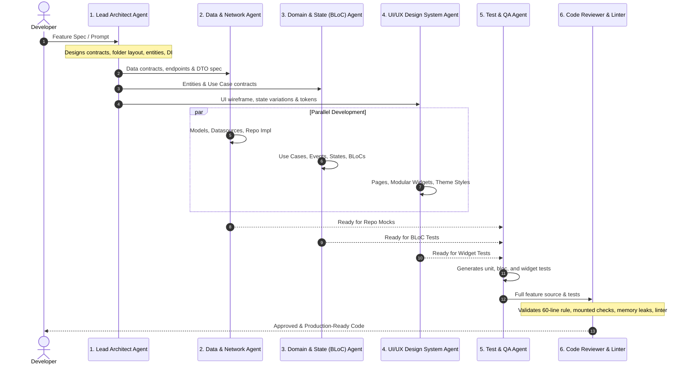

# 🚀 Flutter Vibe Coding Multi-Agent System & Skills

A production-grade, anti-spaghetti architectural framework and multi-agent skill suite for **vibe coding Flutter applications** with AI coding assistants (Antigravity, Cursor, Claude Code, Windsurf, Copilot, etc.).

---

## 🎯 The Problem with Unconstrained Vibe Coding

When you build Flutter applications using general-purpose AI prompts without guardrails, AI models frequently introduce:
- **Monolithic God-Widgets**: 400+ line `build()` methods filled with nested layout soup.
- **Leaky Architectural Boundaries**: Direct Dio/HTTP calls inside `onPressed` or `initState`.
- **Async Gap Bugs**: Using `BuildContext` across `await` without `mounted` checks.
- **Memory Leaks**: Undisposed `TextEditingController`, `AnimationController`, or `StreamSubscription`.
- **Untestable State**: Tightly-coupled singletons and non-injected dependencies.
- **UI Overflow Disasters**: Unhandled keyboard view insets and static text scaling.

---

## 🛡️ The Solution: Rules + 6 Specialized Agents

This repository provides **non-negotiable rules**, an **orchestrated 6-agent system**, and **modular skill files** that keep your codebase clean, scalable, maintainable, and 100% testable.

### 6-Agent Orchestration Pipeline



---

## 📂 Repository Structure

| File / Directory | Description |
| :--- | :--- |
| [WORKFLOW.md](file:///Users/neosoft/flutter-skills/WORKFLOW.md) | **Feature Implementation Runbook**: Exact copy-paste prompts for each agent stage (Phase 1 to 6). |
| [RULES.md](file:///Users/neosoft/flutter-skills/RULES.md) | **The Flutter Vibe Coding Manifesto**: Non-negotiable coding standards, 60-line rule, memory disposal, async gap safety, and anti-patterns. |
| [AGENTS.md](file:///Users/neosoft/flutter-skills/AGENTS.md) | **The Multi-Agent Orchestrator**: Detailed roles, system mandates, strict boundaries, and the Definition of Done (DoD). |
| [skills/flutter-architect/](file:///Users/neosoft/flutter-skills/skills/flutter-architect/SKILL.md) | **Lead Architect**: Feature-First Clean Architecture, Domain Entities, Repository Contracts, and `get_it` DI setup. |
| [skills/flutter-data-network/](file:///Users/neosoft/flutter-skills/skills/flutter-data-network/SKILL.md) | **Data & Network Agent**: Dio data sources, DTO models (`fromJson`/`toJson`), caching, and `Either<Failure, T>` mapping. |
| [skills/flutter-bloc-state/](file:///Users/neosoft/flutter-skills/skills/flutter-bloc-state/SKILL.md) | **Domain & State (BLoC) Agent**: Pure UseCases, immutable States/Events, and `bloc_concurrency` (`droppable`, `restartable`). |
| [skills/flutter-ui-design-system/](file:///Users/neosoft/flutter-skills/skills/flutter-ui-design-system/SKILL.md) | **UI/UX Design System Agent**: Atomic sub-widgets (<60 lines), `Theme.of(context)` conformance, `SafeArea`, and responsive layouts. |
| [skills/flutter-navigation-routing/](file:///Users/neosoft/flutter-skills/skills/flutter-navigation-routing/SKILL.md) | **Navigation & Routing Agent**: Declarative routing with `go_router`, auth redirect guards, and `StatefulShellRoute`. |
| [skills/flutter-testing-qa/](file:///Users/neosoft/flutter-skills/skills/flutter-testing-qa/SKILL.md) | **Test & QA Agent**: `mocktail` mocks, `bloc_test` suites for all state paths, and widget tests. |
| [skills/flutter-code-reviewer-linter/](file:///Users/neosoft/flutter-skills/skills/flutter-code-reviewer-linter/SKILL.md) | **Code Reviewer & Linter Agent**: Anti-spaghetti auditor, detecting memory leaks, unmounted contexts, and oversized methods. |
| [templates/core/](file:///Users/neosoft/flutter-skills/templates/core/) | **Core Templates**: Ready-to-use Clean Architecture foundation (`failures.dart`, `exceptions.dart`, `usecase.dart`, `dio_client.dart` with queued token refresh). |
| [templates/analysis_options.yaml](file:///Users/neosoft/flutter-skills/templates/analysis_options.yaml) | **Strict Linter Configuration**: Fatal errors for unmounted context, unawaited futures, and undisposed sinks. |
| [scripts/verify_feature.sh](file:///Users/neosoft/flutter-skills/scripts/verify_feature.sh) | **Quality Gate Script**: Pre-commit verification for formatting, 0 lint errors, and 100% test pass. |

---

## ⚡ Quick Start: Integrating into Your Flutter Project

### 1. Antigravity IDE
Copy the `skills/` folder and `RULES.md` into your project's `.agents/` directory:
```bash
cp -r /path/to/flutter-skills/skills your_flutter_app/.agents/skills/
cp /path/to/flutter-skills/RULES.md your_flutter_app/.agents/rules/flutter.md
cp /path/to/flutter-skills/AGENTS.md your_flutter_app/AGENTS.md
```

### 2. Cursor
Place `RULES.md` in `.cursorrules` or `.cursor/rules/flutter.md`.

### 3. Claude Code / Windsurf
Link `AGENTS.md` and `RULES.md` in `CLAUDE.md` or `.windsurfrules`.

### 4. Enable Strict Static Analysis
Copy the strict linter configuration into your project root:
```bash
cp /path/to/flutter-skills/templates/analysis_options.yaml your_flutter_app/analysis_options.yaml
```
Run the analyzer:
```bash
flutter analyze
```

---

## 📝 License
MIT License. Feel free to use and customize in your commercial and personal Flutter projects.
